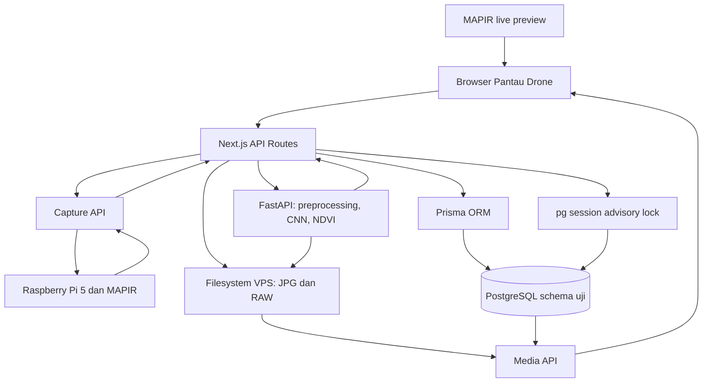

# DreamPalm — Dashboard Analisis Citra MAPIR

Dashboard pengujian DreamPalm untuk pemantauan kamera multispektral MAPIR Survey3W RGN, pengambilan citra JPG dan RAW, analisis CNN dan NDVI, serta penyimpanan hasil pada VPS. Metadata dikelola menggunakan Prisma ORM dan PostgreSQL, sedangkan file citra disimpan pada filesystem VPS, bukan Supabase Storage.

**Status per 27 November 2026:** deployed pada web uji dan lulus pengujian fungsional end-to-end. Integrasi ke website utama merupakan tahap berikutnya.

| Informasi | Referensi |
| --- | --- |
| Web uji | [uji.dreampalm.id](https://uji.dreampalm.id) |
| Repository | [ilhambonardoo/drone-project](https://github.com/ilhambonardoo/drone-project) |
| Branch implementasi | `feat/prisma-orm-integration` |
| Commit implementasi teruji | `5eb3ddf` (sebelum pembaruan dokumentasi ini) |
| Versi cadangan | `feat/vps-storage-integration` — `3ed72cb` |
| Panduan database | [PRISMA-MIGRATION.md](PRISMA-MIGRATION.md) |
| Template konfigurasi | [env.example](env.example) |

## Daftar Isi

- [Fitur](#fitur)
- [Arsitektur dan alur kerja](#arsitektur-dan-alur-kerja)
- [Teknologi dan struktur proyek](#teknologi-dan-struktur-proyek)
- [Instalasi dan konfigurasi](#instalasi-dan-konfigurasi)
- [Database dan migration](#database-dan-migration)
- [Kontrak API website](#kontrak-api-website)
- [Integrasi Capture API dan FastAPI](#integrasi-capture-api-dan-fastapi)
- [Penyimpanan file](#penyimpanan-file)
- [Pengujian](#pengujian)
- [Deployment VPS](#deployment-vps)
- [Integrasi website utama](#integrasi-website-utama)
- [Troubleshooting](#troubleshooting)
- [Batasan dan keamanan](#batasan-dan-keamanan)

## Fitur

- Live preview MAPIR melalui iframe, terpisah dari mekanisme capture foto.
- Pemeriksaan kesiapan kamera dan status busy setiap 5 detik.
- Capture JPG dan RAW melalui Raspberry Pi 5 dan Capture API.
- Polling status capture tanpa menjalankan inference atau menulis database.
- Analisis melalui endpoint tersendiri, termasuk penyimpanan file original, preprocessing, CNN dan NDVI.
- Penyimpanan metadata melalui Prisma ORM; migration schema dikelola oleh Prisma Migrate.
- Tampilan foto original, klasifikasi Sehat/Terserang, skor CNN, nilai NDVI dan visual NDVI.
- Unduhan JPG, RAW dan NDVI PNG serta preview processed JPG 720 × 720.
- Pemulihan hasil prediksi terbaru setelah refresh dan kelanjutan analisis dengan Capture ID yang sama.
- Advisory lock dan pengecekan prediksi tersimpan untuk mengurangi pemrosesan ganda.

## Arsitektur dan alur kerja



1. Browser memeriksa `/api/mapir/health` dan menampilkan live preview.
2. Operator menekan **Ambil Foto & Analisis**. `POST /api/mapir/capture` memeriksa kesiapan database, memicu kamera, dan mencatat metadata capture awal.
3. Browser menyimpan `capture_id` dan memanggil `GET /api/mapir/status/{captureId}` setiap sekitar 1,5 detik sampai `completed` atau gagal (deadline polling sekitar 120 detik).
4. Setelah status `completed`, browser memanggil `POST /api/mapir/analyze/{captureId}`. Endpoint mengambil session advisory lock, memeriksa prediksi existing, lalu menyimpan JPG dan RAW apabila belum tersedia secara lokal.
5. Backend mengirim JPG original sebagai multipart `file` ke FastAPI. RAW diarsipkan dan tidak menjadi input CNN pada implementasi ini.
6. FastAPI menjalankan preprocessing citra, inference CNN, NDVI, serta membuat processed JPG dan NDVI PNG. Backend memvalidasi respons dan keberadaan file sebelum mencatat metadata prediksi.
7. Website menampilkan hasil analisis dan mengakses file melalui Media API. Saat refresh, `GET /api/predictions/latest` membaca hasil dari database tanpa memicu kamera atau inference ulang.
8. Jika proses terputus, Capture ID disimpan dalam `sessionStorage`. Gunakan **Lanjutkan Analisis** dengan ID yang sama setelah memastikan analisis sebelumnya tidak lagi berjalan. Prediksi yang sudah tersimpan dikembalikan tanpa inference ulang.

## Teknologi dan struktur proyek

| Komponen | Teknologi |
| --- | --- |
| Web | Next.js 16.4.6, App Router, React 19, TypeScript, Tailwind CSS 4 |
| Database | PostgreSQL 16.15, Prisma ORM / Client / adapter-pg 7.10.1 |
| Migration | Prisma Migrate 7.10.1 |
| Lock database | `pg`, session advisory lock |
| Inference | FastAPI, CNN `DreamPalm_CNN_720_AreaLuar` |
| Perangkat | Raspberry Pi 5, MAPIR Survey3W RGN |
| Storage | Filesystem VPS |
| Deployment | Nginx, HTTPS, systemd |
| Node.js | VPS teruji v20.20.2; untuk pengembangan/test disarankan Node 22.12+ dalam seri 22 |

```text
prisma/
  schema.prisma
  migrations/0_init/migration.sql
  migrations/migration_lock.toml
prisma.config.ts
src/
  app/
    page.tsx
    layout.tsx
    globals.css
    api/
      mapir/health/route.ts
      mapir/capture/route.ts
      mapir/status/[captureId]/route.ts
      mapir/analyze/[captureId]/route.ts
      predictions/latest/route.ts
      media/[...path]/route.ts
  components/
    CameraPreview.tsx
    PredictionCard.tsx
  lib/
    prisma.ts             # Prisma Client + PostgreSQL adapter
    captureDb.ts          # CRUD metadata dan pengecekan media
    db.ts                 # pool pg / session advisory lock
    captureStorage.ts     # download dan penyimpanan original JPG/RAW
    mediaUrl.ts           # validasi dan resolusi path media
    mapirClient.ts        # Capture API dan validasi origin
    inferenceClient.ts    # FastAPI dan validasi respons
    predictionResult.ts   # transformasi data menjadi respons website
    errors.ts
  types/index.ts
  scripts/
    test-prisma-connection.ts
    test-prisma-smoke.ts
  __tests__/
next.config.ts
package.json
package-lock.json
.env                     # lokal, tidak di-commit
env.example
PRISMA-MIGRATION.md
```

## Instalasi dan konfigurasi

### Prasyarat

- Node.js 22.12+ (seri 22) untuk script pengujian TypeScript existing; runtime dan build VPS telah diuji menggunakan Node.js 20.20.2.
- npm, Git, PostgreSQL 16 dan database pengembangan terpisah.
- Akses Capture API, stream MAPIR dan FastAPI apabila melakukan pengujian end-to-end.
- Direktori storage yang dapat dibaca/ditulis service web dan FastAPI; keduanya harus melihat file yang sama.

```bash
git clone -b feat/prisma-orm-integration https://github.com/ilhambonardoo/drone-project.git
cd drone-project
npm ci
cp env.example .env
npm run db:generate
npx prisma validate
```

Isi `.env` sesuai lingkungan sebelum menjalankan server. Gunakan `.env` (bukan hanya `.env.local`) karena script `db:check`, `db:smoke`, dan konfigurasi Prisma menggunakan file tersebut. Jangan menyalin kredensial produksi ke laptop atau repository.

### Environment variables

| Variable | Scope | Keterangan |
| --- | --- | --- |
| `NEXT_PUBLIC_MAPIR_STREAM_URL` | Browser/build | URL iframe live preview |
| `DREAMPALM_API_URL` | Server | Base URL Capture API, termasuk `/v1/mapir` |
| `DREAMPALM_API_KEY` | Server | API key Capture API |
| `FASTAPI_URL` | Server | Base URL FastAPI; web uji menggunakan port 8002 |
| `DATABASE_URL` | Server | Koneksi PostgreSQL role aplikasi |
| `MIGRATION_DATABASE_URL` | CLI migration | Koneksi role migration terpisah, wajib `schema=uji` jika diisi |
| `DREAMPALM_STORAGE_ROOT` | Server | Root filesystem storage |
| `SUPABASE_STORAGE_URL` | Legacy/build | Dibiarkan kosong; masih terdapat konfigurasi remotePatterns lama di `next.config.ts`, bukan storage aktif |

Contoh `.env` untuk database pengembangan terpisah (ganti semua placeholder, URL-encode password):

```dotenv
NEXT_PUBLIC_MAPIR_STREAM_URL=https://stream.dreampalm.id/dreampalm/
DREAMPALM_API_URL=https://api.dreampalm.id/v1/mapir
DREAMPALM_API_KEY=<CAPTURE_API_KEY>
FASTAPI_URL=http://127.0.0.1:8002
DATABASE_URL=postgresql://dreampalm_prisma_test_app:<APP_PASSWORD>@127.0.0.1:5432/dreampalm_prisma_test
MIGRATION_DATABASE_URL=postgresql://dreampalm_prisma_test_owner:<MIGRATION_PASSWORD>@127.0.0.1:5432/dreampalm_prisma_test?schema=uji
DREAMPALM_STORAGE_ROOT=./storage
SUPABASE_STORAGE_URL=
```

Contoh mengasumsikan PostgreSQL dan FastAPI tersedia secara lokal. Jika pengembangan memakai tunnel, sesuaikan host/port; jangan membuka port database ke internet. Untuk pengujian kamera asli, koordinasikan terlebih dahulu dengan operator. Jangan menjalankan server yang memiliki akses kamera/database pada jaringan publik tanpa autentikasi.

Setelah database dan hak akses siap (lihat bagian berikut):

```bash
npm run db:check
npm run dev
```

Buka `http://localhost:3000`. Restart server setelah mengubah environment; perubahan variabel `NEXT_PUBLIC_` pada production memerlukan build ulang.

## Database dan migration

### Model data

| Model Prisma | Tabel PostgreSQL | Fungsi |
| --- | --- | --- |
| `Capture` | `uji.captures` | ID capture, identitas drone jika tersedia, timestamp, status, ukuran dan path JPG/RAW |
| `Prediction` | `uji.predictions` | UUID prediksi, Capture ID, klasifikasi, skor, NDVI, band, path hasil, metadata model dan flag validasi |

Relasi `Capture` ke `Prediction` adalah one-to-many, dengan foreign key `predictions.capture_id` (`ON DELETE RESTRICT`, `ON UPDATE NO ACTION`). Capture ID menjadi primary key tabel captures; Prediction ID UUID menjadi primary key tabel predictions. Index dan CHECK constraints existing dipertahankan di `prisma/migrations/0_init/migration.sql`. Tidak ada unique constraint untuk `predictions.capture_id` pada baseline; pencegahan pemrosesan ganda dilakukan pada alur aplikasi.

Status database capture: `pending`, `stored`, `failed`. Status upstream kamera `completed` tidak sama dengan status database `stored`. Ukuran file disimpan sebagai BIGINT, lalu dikonversi dengan pemeriksaan pada database layer. File citra tidak disimpan sebagai blob di PostgreSQL.

### Setup database kosong untuk developer

Buat database terpisah bernama `dreampalm_prisma_test` dan role migration owner serta role aplikasi menggunakan administrator PostgreSQL. Jangan menggunakan database aktif untuk smoke test. Rincian pembuatan role dan backup terdapat di [PRISMA-MIGRATION.md](PRISMA-MIGRATION.md); panduan tersebut berasal dari tahap patch awal, gunakan versi dependency yang sudah terkunci pada `package-lock.json` saat ini (7.10.1), bukan menginstal versi lama atau mengekstrak patch lagi.

Setelah `MIGRATION_DATABASE_URL` menargetkan database test yang benar dan schema `uji`:

```bash
npm run db:migrate
npx prisma migrate status
```

Berikan hak runtime berikut sebagai admin/owner pada **database test**:

```sql
GRANT CONNECT ON DATABASE dreampalm_prisma_test TO dreampalm_prisma_test_app;
GRANT USAGE ON SCHEMA uji TO dreampalm_prisma_test_app;
GRANT SELECT, INSERT, UPDATE ON uji.captures TO dreampalm_prisma_test_app;
GRANT SELECT, INSERT ON uji.predictions TO dreampalm_prisma_test_app;
```

Sesuaikan nama role dengan lingkungan lokal. Jangan memberikan role aplikasi hak DDL, superuser atau akses ke tabel riwayat migration. Role owner menjalankan migration, role aplikasi menjalankan CRUD.

```bash
npm run db:check
npm run db:smoke
```

### Database existing VPS

- Database `db_dreampalm`, schema `uji`, telah di-baseline dengan `prisma migrate resolve --applied 0_init` setelah backup, perbandingan struktur, dan validasi checksum.
- `uji._prisma_migrations` terpisah dari `public._prisma_migrations` milik schema existing lainnya.
- Role aplikasi: `dreampalm_uji`. Role migration: `dreampalm_uji_migrator` (NOLOGIN setelah baseline).
- Tabel bisnis tetap dimiliki `postgres`; role migration memiliki izin membuat objek di schema `uji`, tetapi belum menjadi owner tabel bisnis. Migration DDL berikutnya perlu review hak akses administrator.
- Tidak perlu mengulang baseline atau migration awal untuk menggunakan aplikasi yang sudah aktif. Jangan menjalankan `migrate reset`, `db push`, atau `migrate dev` terhadap database VPS existing.

Untuk database existing lainnya, backup schema/data dan file terkait, bandingkan struktur dan history, lalu tentukan baseline bersama administrator. Jangan menyalin migration awal secara membabi buta ke schema website utama.

## Kontrak API website

Base URL web uji: `https://uji.dreampalm.id`. Seluruh route pada web uji dilindungi Nginx Basic Auth. Browser menggunakan relative URL same-origin; API bukan endpoint publik tanpa autentikasi.

| Method | Endpoint | Fungsi |
| --- | --- | --- |
| GET | `/api/mapir/health` | Status kamera dan capture busy |
| POST | `/api/mapir/capture` | Trigger capture dan pencatatan metadata awal |
| GET | `/api/mapir/status/{captureId}` | Polling status kamera, tanpa side effect analisis |
| POST | `/api/mapir/analyze/{captureId}` | Penyimpanan original, inference, metadata prediksi atau hasil existing |
| GET | `/api/predictions/latest` | Membaca hasil prediksi terakhir |
| GET | `/api/media/{path}` | Stream file berdasarkan path dan metadata terdaftar |

### Health

Contoh bentuk respons upstream (identitas drone dan IP dapat tidak tersedia):

```json
{
  "raspberry_pi": "online",
  "mapir": { "ready": true },
  "capture_busy": false
}
```

### Capture dan polling status

`POST /api/mapir/capture` tidak memerlukan body pada implementasi web uji. Contoh respons sukses:

```json
{
  "capture_id": "CAP-20261127-194031-609E",
  "status": "pending"
}
```

Jika kamera telah dipicu tetapi metadata belum tercatat, HTTP 207 mengembalikan `capture_id`, `status`, `dbError: true`, dan `message`. Lanjutkan menggunakan ID yang sama; jangan otomatis trigger ulang.

`GET /api/mapir/status/{captureId}` hanya mengembalikan `capture_id` dan `status`. Contoh saat selesai:

```json
{
  "capture_id": "CAP-20261127-194031-609E",
  "status": "completed"
}
```

### Analyze dan latest prediction

`POST /api/mapir/analyze/{captureId}` mengembalikan objek `StoredPredictionResult` secara langsung. `GET /api/predictions/latest` membungkus objek yang sama dalam `{ "result": ... }`, atau `{ "result": null }` bila database kosong. Tidak boleh menganggap route status mengembalikan `mlResult`.

Contoh bentuk respons analyze (menggunakan data pengujian sebelumnya yang terverifikasi):

```json
{
  "captureId": "CAP-20261127-161452-2562",
  "originalJpgUrl": "/api/media/captures/CAP-20261127-161452-2562/original.jpg",
  "originalRawUrl": "/api/media/captures/CAP-20261127-161452-2562/original.raw",
  "mlResult": {
    "success": true,
    "predictionId": "d8d3bb8e-717f-4278-a3ea-710a5d076d56",
    "processedJpgPath": "predictions/d8d3bb8e-717f-4278-a3ea-710a5d076d56/processed.jpg",
    "ndviVisualPath": "predictions/d8d3bb8e-717f-4278-a3ea-710a5d076d56/ndvi.png",
    "modelName": "DreamPalm_CNN_720_AreaLuar",
    "modelStatus": "prototype_exploratory",
    "classification": "Terserang",
    "classIndex": 1,
    "scoreTerserang": 0.952422,
    "scoreSehat": 0.047578,
    "predictionScore": 0.952422,
    "scoreCalibrated": false,
    "threshold": 0.5,
    "ndvi": 0.030173,
    "bands": { "green": 0.028603, "red": 0.029939, "nir": 0.02569 },
    "validPixelPercentage": 100,
    "snapshotThumbnail": "/api/media/predictions/d8d3bb8e-717f-4278-a3ea-710a5d076d56/processed.jpg",
    "snapshotNDVI": "/api/media/predictions/d8d3bb8e-717f-4278-a3ea-710a5d076d56/ndvi.png",
    "radiometricMode": "mapir_jpg_div255_provisional",
    "radiometricValidated": false,
    "physicalCoverageTargetMeters": 10,
    "physicalCoverageValidated": false,
    "automaticSprayingAllowed": false
  }
}
```

- `originalJpgUrl` untuk foto asli. `snapshotThumbnail` untuk JPG hasil preprocessing, bukan foto asli.
- Skor menggunakan skala 0–1; kalikan 100 untuk tampilan persentase, bukan akurasi model.
- NDVI, band, validPixelPercentage, physicalCoverageTargetMeters dan URL original dapat bernilai `null` sesuai tipe data.
- `src/types/index.ts`, `src/lib/predictionResult.ts` dan API Routes menjadi referensi kontrak aktual.

### Error handling

| Kondisi | HTTP / code | Tindakan |
| --- | --- | --- |
| Capture ID/path tidak valid | 400 | Periksa ID/path |
| Mutation bukan same-origin | 403 / `ORIGIN_DENIED` | Gunakan backend same-origin yang benar |
| Analisis sedang berlangsung | 409 / `ANALYSIS_BUSY` | Jangan trigger ulang; periksa status |
| Capture belum selesai / RAW belum ada | 422 / `CAPTURE_PENDING` atau `RAW_PENDING` | Lanjutkan dengan ID yang sama |
| Capture gagal | 422 / `CAPTURE_FAILED` | Periksa kamera sebelum capture baru |
| Penyimpanan atau upstream gagal | 502 | Periksa koneksi dan storage sebelum retry |
| FastAPI timeout | 504 / `ML_UNKNOWN` | Proses mungkin masih berjalan; periksa sebelum retry |
| Hasil ML belum tercatat | 500 / `ML_UNKNOWN` | Periksa database dan file; hindari retry otomatis |
| Database belum siap / media tidak dapat diakses | 503 | Periksa service dan koneksi database |

Tabel ini merangkum kondisi utama, bukan seluruh status error. Session advisory lock dan pengecekan prediksi tersimpan membantu idempotensi, tetapi tidak memberikan jaminan exactly-once ketika koneksi atau proses terputus.

## Integrasi Capture API dan FastAPI

### Capture API Raspberry Pi

Base URL: `https://api.dreampalm.id/v1/mapir`.

| Method | Endpoint upstream | Fungsi |
| --- | --- | --- |
| GET | `/health` | Kesiapan MAPIR |
| POST | `/captures` | Trigger foto |
| GET | `/captures/{captureId}` | Status dan informasi file capture |
| GET | `/captures/{captureId}/jpg` | JPG original |
| GET | `/captures/{captureId}/raw` | RAW original |

Backend menggunakan header `X-DreamPalm-Key` untuk trigger dan request capture. Unduhan menggunakan URL file yang diberikan oleh upstream dan divalidasi oleh `captureStorage.ts`. Jangan menaruh API key di frontend. Health route tidak mengirim API key; jangan mengasumsikan semua endpoint upstream telah dilindungi autentikasi.

Live preview: `https://stream.dreampalm.id/dreampalm/`. Live preview tidak digunakan sebagai input inference; analisis menggunakan JPG yang dihasilkan oleh capture.

### FastAPI ML

Base URL internal VPS: `http://127.0.0.1:8002`.

```http
POST /process-snapshot
Content-Type: multipart/form-data
```

Field: `file` berisi JPG original. Timeout permintaan inference dari Next.js adalah 60 detik. Tidak ada retry otomatis pada inference yang hasilnya belum dapat dipastikan.

Model `DreamPalm_CNN_720_AreaLuar` menggunakan citra hasil center crop dan resize 720 × 720, ekstraksi Green/Red/NIR, normalisasi dan mask area tengah. NDVI dihitung dari kanal sebelum normalisasi model. FastAPI menyimpan processed JPG dan visualisasi NDVI pada storage VPS yang juga diakses Next.js. `inferenceClient.ts` memvalidasi `predictionId`, path kedua file, hasil klasifikasi, skor, band dan flag keselamatan sebelum mencatat prediksi. Respons dengan `automaticSprayingAllowed: true` ditolak.

FastAPI merupakan layanan terpisah; source model dan service kamera tidak menjadi bagian dari proses build Next.js ini.

## Penyimpanan file

Root storage web uji: `/srv/dreampalm-storage/uji`.

```text
/srv/dreampalm-storage/uji/
  captures/
    <captureId>/
      original.jpg
      original.raw
  predictions/
    <predictionId>/
      processed.jpg
      ndvi.png
```

Media API mengakses file melalui relative path yang terdaftar di database. Contoh URL:

- `/api/media/captures/{captureId}/original.jpg`
- `/api/media/captures/{captureId}/original.raw`
- `/api/media/predictions/{predictionId}/processed.jpg`
- `/api/media/predictions/{predictionId}/ndvi.png`

Media API menggunakan streaming, validasi ID dan nama file, pemeriksaan metadata Prisma, serta penolakan path traversal dan symbolic link. RAW dikirim sebagai attachment; JPG/PNG dapat ditampilkan inline. Implementasi ini tidak menyediakan jaminan HTTP Range/resumable download. Pengunduhan RAW lengkap telah diuji melalui browser.

Jangan membuka folder storage sebagai static directory publik. Lakukan backup database dan filesystem secara konsisten agar metadata tetap cocok dengan file.

## Pengujian

### Script developer

```bash
npm ci
npm run db:generate
npx prisma validate
npx tsc --noEmit
npm run lint
npm test
npm run build
npm audit --omit=dev
```

`prebuild` dan `pretest` melakukan generate Prisma Client. Gunakan Node.js 22 untuk script test TypeScript yang menggunakan experimental strip-types/loader.

Setelah setup database test terpisah:

```bash
npm run db:check  # read-only
npm run db:smoke  # hanya dreampalm_prisma_test yang disposable
```

Smoke test menjalankan CRUD, idempotency, relasi, metadata media, BigInt, rollback dan advisory lock. Smoke test tidak memicu kamera dan tidak membuat file citra. Jangan menjalankannya pada database aktif.

### Hasil terverifikasi — 27 November 2026

| Pengujian | Hasil |
| --- | --- |
| Schema validation, TypeScript, ESLint, production build | PASS |
| Unit tests | 28/28 PASS |
| Audit production dependencies | 0 vulnerabilities saat pengujian; audit seluruh dependensi VPS melaporkan 7 moderate |
| Fresh migration, checksum, perbandingan struktur schema | PASS |
| Smoke test dan rollback database pengujian | PASS |
| Baselining database existing dan read-only Prisma | PASS |
| Perbandingan respons latest API versi lama/baru | Identik |
| Deployment systemd dan akses HTTPS | PASS |
| Capture MAPIR, inference CNN dan NDVI | PASS |
| Penyimpanan PostgreSQL dan filesystem | PASS |
| Unduh original JPG, original RAW, NDVI PNG; preview processed JPG | PASS |

Bukti pengujian end-to-end setelah deployment Prisma:

- Capture ID: `CAP-20261127-194031-609E`
- Prediction ID: `fb8aa6e1-7a0b-4ae3-84e5-1a8d9d520533`
- Klasifikasi: Terserang, skor CNN 83,2%, NDVI -0,0961.
- Jumlah captures bertambah 7 → 8; predictions bertambah 3 → 4.
- Seluruh file tersedia pada filesystem: original JPG 3,1 MB, original RAW sekitar 18 MB (`ls -lh`), processed JPG 15 KB, NDVI PNG 257 KB. Browser menyelesaikan download RAW 17,2 MB.

Citra pengujian adalah citra ruangan, bukan tajuk kelapa sawit. Hasil tersebut menunjukkan keberhasilan alur sistem, bukan akurasi atau validitas diagnosis penyakit.

## Deployment VPS

| Komponen web uji | Konfigurasi |
| --- | --- |
| Website | `https://uji.dreampalm.id` |
| Next.js | `127.0.0.1:3001` |
| FastAPI ML | `127.0.0.1:8002` |
| PostgreSQL | `127.0.0.1:5432` |
| Direktori aktif | `/home/dreampalm/dreampalm-prisma-stage` |
| Service web | `dreampalm-uji-web.service` |
| Service FastAPI | `dreampalm-uji-ml-api.service` |
| Systemd override | `/etc/systemd/system/dreampalm-uji-web.service.d/10-prisma.conf` |
| Direktori rollback | `/srv/dreampalm-uji-web` — commit `3ed72cb` |

**Direktori `dreampalm-prisma-stage` kini digunakan oleh website aktif. Jangan menghapus worktree tersebut.** Meskipun namanya staging, systemd menjalankannya pada port 3001. Port 3002 hanya dipakai sementara selama validasi, bukan endpoint publik.

Untuk release berikutnya, siapkan build di direktori terpisah terlebih dahulu. Gunakan `npm ci` termasuk devDependencies, generate, validasi dan build sebelum mengubah service. Backup data dan file terkait jika ada perubahan schema atau storage. Lakukan maintenance window tanpa capture aktif, lalu verifikasi API, akses media dan hasil terbaru sebelum serta setelah pergantian service.

### Pemeriksaan service (administrator VPS)

```bash
sudo systemctl is-active dreampalm-uji-web.service
sudo systemctl is-active dreampalm-uji-ml-api.service
sudo systemctl show dreampalm-uji-web.service -p WorkingDirectory -p ExecStart --no-pager
curl -fsS http://127.0.0.1:3001/api/predictions/latest
sudo journalctl -u dreampalm-uji-web.service -n 30 --no-pager
```

Jangan menjalankan `npm run start` tambahan pada port aktif. Website dikelola systemd, sedangkan Nginx menyediakan HTTPS dan Basic Auth. Next.js harus bind ke loopback agar autentikasi Nginx tidak dapat dilewati. Jangan membuka port internal langsung ke internet.

### Rollback release Prisma saat ini

Hanya untuk administrator VPS apabila release aktif mengalami masalah, tidak ada perubahan lain pada konfigurasi override, dan tidak ada capture/analisis aktif. Simpan konfigurasi override sebelum menghapusnya. Versi lama menggunakan tabel bisnis yang sama; baseline tidak mengubah tabel tersebut.

```bash
sudo cp /etc/systemd/system/dreampalm-uji-web.service.d/10-prisma.conf /root/dreampalm-10-prisma.conf.rollback
sudo rm /etc/systemd/system/dreampalm-uji-web.service.d/10-prisma.conf
sudo systemctl daemon-reload
sudo systemctl restart dreampalm-uji-web.service
sudo systemctl is-active dreampalm-uji-web.service
```

Pastikan WorkingDirectory kembali ke `/srv/dreampalm-uji-web`, lalu uji API dan HTTPS. Tidak perlu menghapus history Prisma atau restore database hanya untuk rollback kode aplikasi. Jika struktur database berubah pada release mendatang, evaluasi kompatibilitas rollback terlebih dahulu.

## Integrasi website utama

Gunakan branch `feat/prisma-orm-integration` sebagai referensi implementasi, bukan langsung merge seluruh UI/schema web uji. Pertahankan autentikasi, role pengguna, dashboard, perangkat, pengaturan, peta dan fitur existing. Telemetri Pixhawk ditangani terpisah.

| Bagian | Target integrasi |
| --- | --- |
| Pantau Drone | Live preview, capture, status proses, foto original, klasifikasi CNN, skor, NDVI, visual NDVI |
| Log Prediksi | Riwayat hasil, detail waktu/drone, klasifikasi, skor, NDVI, download JPG/RAW/NDVI, preview processed JPG |
| Backend | Adaptasi alur trigger → polling → analyze; jangan menjalankan inference pada status route |
| Prisma | Sesuaikan model, relasi drone/user, role dan migration dengan schema existing website utama |
| Media | Terapkan autentikasi operator dan pemeriksaan hak akses per drone/capture |
| Log Prediksi API | Endpoint list/detail, filter dan pagination perlu dikembangkan; saat ini web uji hanya memiliki endpoint latest |

### Jika website utama menggunakan Vercel

`127.0.0.1:8002`, `127.0.0.1:5432`, dan `/srv/dreampalm-storage/uji` merujuk ke lingkungan VPS, bukan lingkungan Vercel. Jangan memindahkan kode server yang bergantung pada filesystem tersebut ke Vercel tanpa perubahan arsitektur.

Rekomendasi target: frontend/backend autentikasi website utama → gateway HTTPS yang terautentikasi → backend VPS → Capture API, FastAPI, PostgreSQL dan filesystem VPS. Gateway untuk website utama belum diimplementasikan. Mutation browser web uji saat ini mewajibkan same-origin dan tidak dirancang sebagai API lintas domain langsung. Tim software perlu menentukan mekanisme autentikasi antarlayanan, otorisasi operator, timeout, serta URL/proxy media untuk browser. Jangan menyelesaikannya dengan menonaktifkan pemeriksaan origin atau membuka database/ML ke internet.

## Troubleshooting

| Masalah | Pemeriksaan |
| --- | --- |
| MAPIR tidak siap | Cek Capture API `/health`, Raspberry Pi, kamera, koneksi jaringan dan `capture_busy` |
| Trigger gagal | Cek database, base URL termasuk `/v1/mapir`, API key server-only dan status kamera. Jika status trigger tidak pasti, jangan langsung trigger ulang |
| Capture selesai tetapi analisis gagal | Cek ketersediaan JPG/RAW, log web dan FastAPI, shared storage serta database. Lanjutkan Capture ID yang sama setelah proses sebelumnya berhenti |
| `P1000` Prisma | Verifikasi role dan password via psql, URL-encode password, cek URL migration vs URL aplikasi. Jangan reset role lain |
| `db:check` gagal | Periksa target database/role, SSH tunnel bila dipakai, hak SELECT pada schema `uji`, Prisma Client dan versi Node.js |
| Gambar tidak tampil | Cek metadata/path file, izin baca service dan root storage yang sama; tidak memerlukan Supabase bucket |
| `ENOENT package.json` | Jalankan npm dari root proyek, bukan home directory umum |
| `EBADENGINE` atau warning loader | Gunakan Node.js 22 yang kompatibel untuk development/test. VPS Node 20.20.2 lulus generate, build dan E2E, tetapi dependency `@prisma/streams-local` meminta Node >=22; evaluasi upgrade runtime secara terpisah |

## Batasan dan keamanan

- Model berstatus `prototype_exploratory`; skor CNN belum terkalibrasi (`scoreCalibrated=false`).
- NDVI dari JPG menggunakan mode `mapir_jpg_div255_provisional`; validasi radiometrik dan cakupan fisik belum selesai.
- `automaticSprayingAllowed=false`; hasil model hanya advisory dan tidak mengaktifkan penyemprotan otomatis.
- Web uji memakai Basic Auth Nginx, belum memiliki otorisasi granular per operator/drone pada Media API. Integrasi website utama wajib menambahkan pemeriksaan tersebut.
- Identitas drone dan waktu capture dapat kosong jika tidak diberikan oleh upstream. Integrasikan dengan data drone yang terdaftar, jangan mengarang metadata.
- Advisory lock membantu mencegah pemrosesan bersamaan, tetapi bukan jaminan exactly-once. Recovery setelah gangguan jaringan, offline buffering, orphan file cleanup, dan uji concurrency/failure lapangan masih perlu dikembangkan.
- Jangan commit `.env`, password, token, API key atau private key. Bagikan hanya kredensial minimum yang diperlukan melalui jalur aman; kredensial migration tetap dikelola administrator.
- Pertahankan lockfile teruji. Jangan menjalankan `npm audit fix --force` atau upgrade mayor Prisma tanpa validasi ulang.

## Referensi

- [Prisma ORM](https://www.prisma.io/docs)
- [Next.js](https://nextjs.org/docs)
- [React](https://react.dev/)
- [Tailwind CSS](https://tailwindcss.com/docs)
- [FastAPI](https://fastapi.tiangolo.com/)
- [Panduan migration repository](PRISMA-MIGRATION.md)
